# Alignment training pipeline (demo) — lineage

> Generated by `scripts/registry.py` from `pipeline.yaml` and `experiments/`. Do not edit by hand.

**Current main:** `rlhf2-v1`

```mermaid
flowchart LR
  base(["base<br/>@0a1b2c3"])
  exp_001["exp-001 · SFT<br/>accepted<br/><small>example-org/training@1f0e9d8</small>"]
  base --> exp_001
  sft_v1(["sft-v1<br/>@5d2c7a1"])
  exp_001 --> sft_v1
  exp_002["exp-002 · RLHF 1<br/>accepted<br/><small>example-org/training@2a7b4c6</small>"]
  sft_v1 --> exp_002
  rlhf1_v1(["rlhf1-v1<br/>@9e3f1b0"])
  exp_002 --> rlhf1_v1
  exp_003["exp-003 · DPO<br/>accepted<br/><small>example-org/training@3c8d5e7</small>"]
  rlhf1_v1 --> exp_003
  dpo_v1(["dpo-v1<br/>@7b4a2d9"])
  exp_003 --> dpo_v1
  exp_004["exp-004 · RLVR<br/>accepted<br/><small>example-org/training@4d9e6f8</small>"]
  dpo_v1 --> exp_004
  rlvr_a_v1(["rlvr-a-v1<br/>@6a1c3e5"])
  exp_004 --> rlvr_a_v1
  rlvr_a_v2(["rlvr-a-v2<br/>@8c2e4f6"])
  exp_004 --> rlvr_a_v2
  exp_005["exp-005 · RLVR<br/>accepted<br/><small>example-org/training@5e0f7a9</small>"]
  dpo_v1 --> exp_005
  rlvr_b_v1(["rlvr-b-v1<br/>@2f5b8d1"])
  exp_005 --> rlvr_b_v1
  exp_006["exp-006 · Souping<br/>accepted<br/><small>example-org/merging@8f3a21c</small>"]
  rlvr_a_v1 -->|0.2| exp_006
  rlvr_a_v2 -->|0.4| exp_006
  rlvr_b_v1 -->|0.4| exp_006
  soup_v1(["soup-v1<br/>@4c1d9e2"])
  exp_006 --> soup_v1
  exp_007["exp-007 · OPSD<br/>accepted<br/><small>example-org/training@6f1a8b0</small>"]
  soup_v1 --> exp_007
  opsd_v1(["opsd-v1<br/>@3d7f9a2"])
  exp_007 --> opsd_v1
  exp_008["exp-008 · RLHF 2<br/>accepted<br/><small>example-org/training@7a2b9c1</small>"]
  opsd_v1 --> exp_008
  rlhf2_v1(["rlhf2-v1 · main<br/>@1e6c8b4"])
  exp_008 --> rlhf2_v1
  exp_010["exp-010 · RLVR<br/>running<br/><small>example-org/training@9c4d1e3</small>"]
  dpo_v1 --> exp_010
  classDef lineage fill:#dbeafe,stroke:#2563eb,color:#1e3a8a
  classDef main fill:#dcfce7,stroke:#15803d,color:#14532d,stroke-width:3px
  classDef progress fill:#fef9c3,stroke:#a16207,color:#713f12,stroke-dasharray:2 3
  class base,exp_001,sft_v1,exp_002,rlhf1_v1,exp_003,dpo_v1,exp_004,rlvr_a_v1,rlvr_a_v2,exp_005,rlvr_b_v1,exp_006,soup_v1,exp_007,opsd_v1,exp_008 lineage
  class exp_010 progress
  class rlhf2_v1 main
```

Green: current main · blue: ancestry of main · yellow: in progress · unshaded: accepted, not in main's ancestry.

## Experiments

| Experiment | Phase | Objective | Owner | Status | Parents | Outputs | GitHub code |
| --- | --- | --- | --- | --- | --- | --- | --- |
| exp-001 | SFT | Supervised fine-tuning on the instruction set | [Researcher A](mailto:researcher-a@example.org) (`researcher-a`) | accepted | `base` [example-org/base-model@0a1b2c3](https://huggingface.co/example-org/base-model/tree/0a1b2c3) | `sft-v1` | [example-org/training](https://github.com/example-org/training) @ [1f0e9d8](https://github.com/example-org/training/commit/1f0e9d8) |
| exp-002 | RLHF 1 | First RLHF round | [Researcher B](mailto:researcher-b@example.org) (`researcher-b`) | accepted | `sft-v1` [example-org/sft-v1@5d2c7a1](https://huggingface.co/example-org/sft-v1/tree/5d2c7a1) | `rlhf1-v1` | [example-org/training](https://github.com/example-org/training) @ [2a7b4c6](https://github.com/example-org/training/commit/2a7b4c6) |
| exp-003 | DPO | Preference optimisation on curated pairs | [Researcher A](mailto:researcher-a@example.org) (`researcher-a`) | accepted | `rlhf1-v1` [example-org/rlhf1-v1@9e3f1b0](https://huggingface.co/example-org/rlhf1-v1/tree/9e3f1b0) | `dpo-v1` | [example-org/training](https://github.com/example-org/training) @ [3c8d5e7](https://github.com/example-org/training/commit/3c8d5e7) |
| exp-004 | RLVR | RLVR with unit-test rewards | [Researcher A](mailto:researcher-a@example.org) (`researcher-a`) | accepted | `dpo-v1` [example-org/dpo-v1@7b4a2d9](https://huggingface.co/example-org/dpo-v1/tree/7b4a2d9) | `rlvr-a-v1`, `rlvr-a-v2` | [example-org/training](https://github.com/example-org/training) @ [4d9e6f8](https://github.com/example-org/training/commit/4d9e6f8) |
| exp-005 | RLVR | RLVR with exact-match rewards | [Researcher B](mailto:researcher-b@example.org) (`researcher-b`) | accepted | `dpo-v1` [example-org/dpo-v1@7b4a2d9](https://huggingface.co/example-org/dpo-v1/tree/7b4a2d9) | `rlvr-b-v1` | [example-org/training](https://github.com/example-org/training) @ [5e0f7a9](https://github.com/example-org/training/commit/5e0f7a9) |
| exp-010 | RLVR | RLVR with a longer task horizon | [Researcher C](mailto:researcher-c@example.org) (`researcher-c`) | running | `dpo-v1` [example-org/dpo-v1@7b4a2d9](https://huggingface.co/example-org/dpo-v1/tree/7b4a2d9) | – | [example-org/training](https://github.com/example-org/training) @ [9c4d1e3](https://github.com/example-org/training/commit/9c4d1e3) |
| exp-006 | Souping | Weighted soup of three RLVR checkpoints | [Researcher A](mailto:researcher-a@example.org) (`researcher-a`) | accepted | `rlvr-a-v1` [example-org/rlvr-a@6a1c3e5](https://huggingface.co/example-org/rlvr-a/tree/6a1c3e5) ×0.2 `rlvr-a-v2` [example-org/rlvr-a@8c2e4f6](https://huggingface.co/example-org/rlvr-a/tree/8c2e4f6) ×0.4 `rlvr-b-v1` [example-org/rlvr-b@2f5b8d1](https://huggingface.co/example-org/rlvr-b/tree/2f5b8d1) ×0.4 | `soup-v1` | [example-org/merging](https://github.com/example-org/merging) @ [8f3a21c](https://github.com/example-org/merging/commit/8f3a21c) |
| exp-007 | OPSD | OPSD on the merged checkpoint | [Researcher C](mailto:researcher-c@example.org) (`researcher-c`) | accepted | `soup-v1` [example-org/soup-v1@4c1d9e2](https://huggingface.co/example-org/soup-v1/tree/4c1d9e2) | `opsd-v1` | [example-org/training](https://github.com/example-org/training) @ [6f1a8b0](https://github.com/example-org/training/commit/6f1a8b0) |
| exp-008 | RLHF 2 | Final RLHF alignment round | [Researcher B](mailto:researcher-b@example.org) (`researcher-b`) | accepted | `opsd-v1` [example-org/opsd-v1@3d7f9a2](https://huggingface.co/example-org/opsd-v1/tree/3d7f9a2) | `rlhf2-v1` | [example-org/training](https://github.com/example-org/training) @ [7a2b9c1](https://github.com/example-org/training/commit/7a2b9c1) |

## Checkpoints

Scores produced by [`example-org/evaluation`](https://github.com/example-org/evaluation) at the listed commit.

| Model | Produced by | Checkpoint | math | code | chat | safety | Eval code | Used by |
| --- | --- | --- | ---: | ---: | ---: | ---: | --- | --- |
| `base` | external | [example-org/base-model@0a1b2c3](https://huggingface.co/example-org/base-model/tree/0a1b2c3) | 0.301 | 0.276 | 5.1 | 0.817 | [d41e7aa](https://github.com/example-org/evaluation/commit/d41e7aa) | exp-001 |
| `sft-v1` | exp-001 | [example-org/sft-v1@5d2c7a1](https://huggingface.co/example-org/sft-v1/tree/5d2c7a1) | 0.412 | 0.385 | 6.8 | 0.902 | [d41e7aa](https://github.com/example-org/evaluation/commit/d41e7aa) | exp-002 |
| `rlhf1-v1` | exp-002 | [example-org/rlhf1-v1@9e3f1b0](https://huggingface.co/example-org/rlhf1-v1/tree/9e3f1b0) | 0.437 | 0.401 | 7.3 | 0.931 | [d41e7aa](https://github.com/example-org/evaluation/commit/d41e7aa) | exp-003 |
| `dpo-v1` | exp-003 | [example-org/dpo-v1@7b4a2d9](https://huggingface.co/example-org/dpo-v1/tree/7b4a2d9) | 0.455 | 0.418 | 7.6 | 0.944 | [d41e7aa](https://github.com/example-org/evaluation/commit/d41e7aa) | exp-004, exp-005, exp-010 |
| `rlvr-a-v1` | exp-004 | [example-org/rlvr-a@6a1c3e5](https://huggingface.co/example-org/rlvr-a/tree/6a1c3e5) | 0.498 | 0.502 | 7.4 | 0.938 | [d41e7aa](https://github.com/example-org/evaluation/commit/d41e7aa) | exp-006 |
| `rlvr-a-v2` | exp-004 | [example-org/rlvr-a@8c2e4f6](https://huggingface.co/example-org/rlvr-a/tree/8c2e4f6) | 0.531 | 0.537 | 7.3 | 0.935 | [d41e7aa](https://github.com/example-org/evaluation/commit/d41e7aa) | exp-006 |
| `rlvr-b-v1` | exp-005 | [example-org/rlvr-b@2f5b8d1](https://huggingface.co/example-org/rlvr-b/tree/2f5b8d1) | 0.589 | 0.441 | 7.5 | 0.941 | [d41e7aa](https://github.com/example-org/evaluation/commit/d41e7aa) | exp-006 |
| `soup-v1` | exp-006 | [example-org/soup-v1@4c1d9e2](https://huggingface.co/example-org/soup-v1/tree/4c1d9e2) | 0.612 | 0.548 | 7.6 | 0.946 | [d41e7aa](https://github.com/example-org/evaluation/commit/d41e7aa) | exp-007 |
| `opsd-v1` | exp-007 | [example-org/opsd-v1@3d7f9a2](https://huggingface.co/example-org/opsd-v1/tree/3d7f9a2) | 0.624 | 0.556 | 7.8 | 0.948 | [d41e7aa](https://github.com/example-org/evaluation/commit/d41e7aa) | exp-008 |
| **`rlhf2-v1`** (main) | exp-008 | [example-org/rlhf2-v1@1e6c8b4](https://huggingface.co/example-org/rlhf2-v1/tree/1e6c8b4) | 0.619 | 0.553 | 8.2 | 0.963 | [d41e7aa](https://github.com/example-org/evaluation/commit/d41e7aa) | – |

## Rejected experiments

Rejected work is kept as [closed issues labelled `rejected`](https://github.com/alobo01/lightweight-model-version-control/issues?q=is%3Aissue+is%3Aclosed+label%3Arejected), with its parents, checkpoints, scores and the reason it was dropped.
