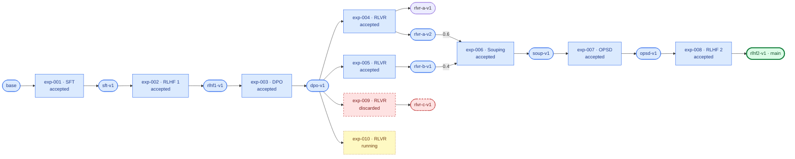

# Alignment training pipeline (demo) — lineage

> Generated by `scripts/registry.py` from `pipeline.yaml` and `experiments/`. Do not edit by hand.

**Current main:** `rlhf2-v1`

Green: current main · blue: ancestry of main · yellow: in progress · red: discarded · unshaded: accepted, not in main's ancestry.

## Experiments

| Experiment | Phase | Objective | Owner | Status | Inputs | Outputs | Code |
| --- | --- | --- | --- | --- | --- | --- | --- |
| exp-001 | SFT | Supervised fine-tuning on the instruction set | `researcher-a` | accepted | `base` | `sft-v1` | [example-org/training@1f0e9d8](https://github.com/example-org/training/commit/1f0e9d8) |
| exp-002 | RLHF 1 | First RLHF round | `researcher-b` | accepted | `sft-v1` | `rlhf1-v1` | [example-org/training@2a7b4c6](https://github.com/example-org/training/commit/2a7b4c6) |
| exp-003 | DPO | Preference optimisation on curated pairs | `researcher-a` | accepted | `rlhf1-v1` | `dpo-v1` | [example-org/training@3c8d5e7](https://github.com/example-org/training/commit/3c8d5e7) |
| exp-004 | RLVR | RLVR with unit-test rewards | `researcher-a` | accepted | `dpo-v1` | `rlvr-a-v1`, `rlvr-a-v2` | [example-org/training@4d9e6f8](https://github.com/example-org/training/commit/4d9e6f8) |
| exp-005 | RLVR | RLVR with exact-match rewards | `researcher-b` | accepted | `dpo-v1` | `rlvr-b-v1` | [example-org/training@5e0f7a9](https://github.com/example-org/training/commit/5e0f7a9) |
| exp-009 | RLVR | RLVR with a learned reward model | `researcher-c` | discarded | `dpo-v1` | `rlvr-c-v1` | [example-org/training@8b3c0d2](https://github.com/example-org/training/commit/8b3c0d2) |
| exp-010 | RLVR | RLVR with a longer task horizon | `researcher-c` | running | `dpo-v1` | – | [example-org/training@9c4d1e3](https://github.com/example-org/training/commit/9c4d1e3) |
| exp-006 | Souping | Weighted soup of two RLVR checkpoints | `researcher-a` | accepted | `rlvr-a-v2` ×0.6, `rlvr-b-v1` ×0.4 | `soup-v1` | [example-org/merging@8f3a21c](https://github.com/example-org/merging/commit/8f3a21c) |
| exp-007 | OPSD | OPSD on the merged checkpoint | `researcher-c` | accepted | `soup-v1` | `opsd-v1` | [example-org/training@6f1a8b0](https://github.com/example-org/training/commit/6f1a8b0) |
| exp-008 | RLHF 2 | Final RLHF alignment round | `researcher-b` | accepted | `opsd-v1` | `rlhf2-v1` | [example-org/training@7a2b9c1](https://github.com/example-org/training/commit/7a2b9c1) |

## Checkpoints

| Model | Produced by | Checkpoint | Evaluation | Used by |
| --- | --- | --- | --- | --- |
| `base` | external | [example-org/base-model@0a1b2c3](https://huggingface.co/example-org/base-model/tree/0a1b2c3) | – | exp-001 |
| `sft-v1` | exp-001 | [example-org/sft-v1@5d2c7a1](https://huggingface.co/example-org/sft-v1/tree/5d2c7a1) | [runs/sft-v1](https://github.com/example-org/evaluation/tree/main/runs/sft-v1) | exp-002 |
| `rlhf1-v1` | exp-002 | [example-org/rlhf1-v1@9e3f1b0](https://huggingface.co/example-org/rlhf1-v1/tree/9e3f1b0) | [runs/rlhf1-v1](https://github.com/example-org/evaluation/tree/main/runs/rlhf1-v1) | exp-003 |
| `dpo-v1` | exp-003 | [example-org/dpo-v1@7b4a2d9](https://huggingface.co/example-org/dpo-v1/tree/7b4a2d9) | [runs/dpo-v1](https://github.com/example-org/evaluation/tree/main/runs/dpo-v1) | exp-004, exp-005, exp-009, exp-010 |
| `rlvr-a-v1` | exp-004 | [example-org/rlvr-a@6a1c3e5](https://huggingface.co/example-org/rlvr-a/tree/6a1c3e5) | [runs/rlvr-a-v1](https://github.com/example-org/evaluation/tree/main/runs/rlvr-a-v1) | – |
| `rlvr-a-v2` | exp-004 | [example-org/rlvr-a@8c2e4f6](https://huggingface.co/example-org/rlvr-a/tree/8c2e4f6) | [runs/rlvr-a-v2](https://github.com/example-org/evaluation/tree/main/runs/rlvr-a-v2) | exp-006 |
| `rlvr-b-v1` | exp-005 | [example-org/rlvr-b@2f5b8d1](https://huggingface.co/example-org/rlvr-b/tree/2f5b8d1) | [runs/rlvr-b-v1](https://github.com/example-org/evaluation/tree/main/runs/rlvr-b-v1) | exp-006 |
| `rlvr-c-v1` | exp-009 | [example-org/rlvr-c@5a9d1f3](https://huggingface.co/example-org/rlvr-c/tree/5a9d1f3) | [runs/rlvr-c-v1](https://github.com/example-org/evaluation/tree/main/runs/rlvr-c-v1) | – |
| `soup-v1` | exp-006 | [example-org/soup-v1@4c1d9e2](https://huggingface.co/example-org/soup-v1/tree/4c1d9e2) | [runs/soup-v1](https://github.com/example-org/evaluation/tree/main/runs/soup-v1) | exp-007 |
| `opsd-v1` | exp-007 | [example-org/opsd-v1@3d7f9a2](https://huggingface.co/example-org/opsd-v1/tree/3d7f9a2) | [runs/opsd-v1](https://github.com/example-org/evaluation/tree/main/runs/opsd-v1) | exp-008 |
| **`rlhf2-v1`** (main) | exp-008 | [example-org/rlhf2-v1@1e6c8b4](https://huggingface.co/example-org/rlhf2-v1/tree/1e6c8b4) | [runs/rlhf2-v1](https://github.com/example-org/evaluation/tree/main/runs/rlhf2-v1) | – |

## Discarded work

- **exp-009 — RLVR with a learned reward model** (`researcher-c`): Reward model was exploited; verifiable-task accuracy fell below the DPO parent.
