# Alignment training pipeline (demo) — lineage

> Generated by `scripts/registry.py` from `config.yaml`, `experiments/` and `rejected/`. Do not edit by hand.

**Main branch:** `main`

[Open the interactive HTML view](LINEAGE.html) for zoom, pan and searchable experiment records. Download it or open it from a local checkout in a browser.

```mermaid
---
config:
  theme: base
  fontSize: 24
  themeCSS: "& { background: #f8fafc; border-radius: 16px; }"
  themeVariables:
    fontSize: "24px"
    fontFamily: "Inter, ui-sans-serif, system-ui, sans-serif"
    background: "#f8fafc"
    primaryColor: "#ffffff"
    primaryTextColor: "#1e293b"
    primaryBorderColor: "#cbd5e1"
    lineColor: "#64748b"
    edgeLabelBackground: "#f8fafc"
    clusterBkg: "#f1f5f9"
    clusterBorder: "#e2e8f0"
  flowchart:
    useMaxWidth: false
    nodeSpacing: 70
    rankSpacing: 90
    diagramPadding: 24
    curve: basis
---
flowchart LR
  subgraph lineage_canvas["Experiment lineage"]
    direction LR
  base(["base<br/>@0a1b2c3"])
  exp_001("<b>exp-001</b><br/><small>sft</small><br/>sft<br/>accepted<br/><small>example-org/training@1f0e9d8</small>")
  base --> exp_001
  sft_v1(["sft-v1<br/>@5d2c7a1"])
  exp_001 --> sft_v1
  exp_002("<b>exp-002</b><br/><small>rlhf1</small><br/>rlhf<br/>accepted<br/><small>example-org/training@2a7b4c6</small>")
  sft_v1 --> exp_002
  rlhf1_v1(["rlhf1-v1<br/>@9e3f1b0"])
  exp_002 --> rlhf1_v1
  exp_003("<b>exp-003</b><br/><small>dpo</small><br/>dpo<br/>accepted<br/><small>example-org/training@3c8d5e7</small>")
  rlhf1_v1 --> exp_003
  dpo_v1(["dpo-v1<br/>@7b4a2d9"])
  exp_003 --> dpo_v1
  exp_004("<b>exp-004</b><br/><small>rlvr, code</small><br/>rlvr<br/>accepted<br/><small>example-org/training@4d9e6f8</small>")
  dpo_v1 --> exp_004
  rlvr_a_v1(["rlvr-a-v1<br/>@6a1c3e5"])
  exp_004 --> rlvr_a_v1
  rlvr_a_v2(["rlvr-a-v2<br/>@8c2e4f6"])
  exp_004 --> rlvr_a_v2
  exp_005("<b>exp-005</b><br/><small>rlvr, reasoning</small><br/>rlvr<br/>accepted<br/><small>example-org/training@5e0f7a9</small>")
  dpo_v1 --> exp_005
  rlvr_b_v1(["rlvr-b-v1<br/>@2f5b8d1"])
  exp_005 --> rlvr_b_v1
  exp_006("<b>exp-006</b><br/><small>weight_aggregation, souping</small><br/>weighted_average<br/>accepted<br/><small>example-org/merging@8f3a21c</small>")
  rlvr_a_v1 -->|"weight: 0.2"| exp_006
  rlvr_a_v2 -->|"weight: 0.4"| exp_006
  rlvr_b_v1 -->|"weight: 0.4"| exp_006
  soup_v1(["soup-v1<br/>@4c1d9e2"])
  exp_006 --> soup_v1
  exp_007("<b>exp-007</b><br/><small>opsd</small><br/>opsd<br/>accepted<br/><small>example-org/training@6f1a8b0</small>")
  soup_v1 --> exp_007
  opsd_v1(["opsd-v1<br/>@3d7f9a2"])
  exp_007 --> opsd_v1
  exp_008("<b>exp-008</b><br/><small>rlhf2</small><br/>rlhf<br/>accepted<br/><small>example-org/training@7a2b9c1</small>")
  opsd_v1 --> exp_008
  rlhf2_v1(["rlhf2-v1<br/>@1e6c8b4"])
  exp_008 --> rlhf2_v1
  exp_010("<b>exp-010</b><br/><small>rlvr, reasoning</small><br/>rlvr<br/>in progress<br/><small>example-org/training@9c4d1e3</small>")
  dpo_v1 --> exp_010
  rlvr_d_v1(["rlvr-d-v1<br/>@3a6d8e1"])
  exp_010 --> rlvr_d_v1
  exp_013("<b>exp-013</b><br/><small>dpo, safety</small><br/>dpo<br/>in progress<br/><small>example-org/training@a2c7e49</small>")
  rlhf2_v1 --> exp_013
  exp_014("<b>exp-014</b><br/><small>rlvr, ablation, code</small><br/>rlvr<br/>in progress<br/><small>example-org/training@b3d8f50</small>")
  rlvr_a_v2 --> exp_014
  exp_009("<b>exp-009</b><br/><small>rlvr, reasoning</small><br/>rlvr<br/>rejected<br/><small>example-org/training@8b2e4a6</small>")
  dpo_v1 --> exp_009
  rlvr_c_v1(["rlvr-c-v1<br/>@5a9d1f3"])
  exp_009 --> rlvr_c_v1
  exp_012("<b>exp-012</b><br/><small>weight_aggregation, souping, ablation</small><br/>weighted_average<br/>rejected<br/><small>example-org/merging@8f3a21c</small>")
  rlvr_a_v1 -->|"weight: 0.333"| exp_012
  rlvr_a_v2 -->|"weight: 0.333"| exp_012
  rlvr_b_v1 -->|"weight: 0.333"| exp_012
  soup_uniform_v1(["soup-uniform-v1<br/>@6d2f8a4"])
  exp_012 --> soup_uniform_v1
  subgraph tag_legend["Tags"]
    tag_legend_0["ablation"]
    tag_legend_1["code"]
    tag_legend_2["dpo"]
    tag_legend_3["opsd"]
    tag_legend_4["reasoning"]
    tag_legend_5["rlhf1"]
    tag_legend_6["rlhf2"]
    tag_legend_7["rlvr"]
    tag_legend_8["safety"]
    tag_legend_9["sft"]
    tag_legend_10["souping"]
    tag_legend_11["weight_aggregation"]
  end
  end
  style lineage_canvas fill:#f8fafc,stroke:#e2e8f0,stroke-width:1px,rx:16,ry:16
  classDef default fill:#ffffff,stroke:#cbd5e1,color:#1e293b,stroke-width:1.5px
  classDef tag_0 fill:#f2c4f3,stroke:#9f22a0,color:#1e293b,stroke-width:1.5px
  classDef tag_1 fill:#c4f3c5,stroke:#22a026,color:#1e293b,stroke-width:1.5px
  classDef tag_2 fill:#ccc4f3,stroke:#3822a0,color:#1e293b,stroke-width:1.5px
  classDef tag_3 fill:#f3c4df,stroke:#a0226c,color:#1e293b,stroke-width:1.5px
  classDef tag_4 fill:#f3d1c4,stroke:#a04622,color:#1e293b,stroke-width:1.5px
  classDef tag_5 fill:#d9f3c4,stroke:#5ba022,color:#1e293b,stroke-width:1.5px
  classDef tag_6 fill:#c4cef3,stroke:#223da0,color:#1e293b,stroke-width:1.5px
  classDef tag_7 fill:#f3cec4,stroke:#a03c22,color:#1e293b,stroke-width:1.5px
  classDef tag_8 fill:#c4edf3,stroke:#2290a0,color:#1e293b,stroke-width:1.5px
  classDef tag_9 fill:#e8f3c4,stroke:#82a022,color:#1e293b,stroke-width:1.5px
  classDef tag_10 fill:#c4f3ef,stroke:#22a097,color:#1e293b,stroke-width:1.5px
  classDef tag_11 fill:#c4caf3,stroke:#2231a0,color:#1e293b,stroke-width:1.5px
  class exp_001,sft_v1,tag_legend_9 tag_9
  class exp_002,rlhf1_v1,tag_legend_5 tag_5
  class exp_003,dpo_v1,exp_013,tag_legend_2 tag_2
  class exp_004,rlvr_a_v1,rlvr_a_v2,exp_005,rlvr_b_v1,exp_010,rlvr_d_v1,exp_014,exp_009,rlvr_c_v1,tag_legend_7 tag_7
  class exp_006,soup_v1,exp_012,soup_uniform_v1,tag_legend_11 tag_11
  class exp_007,opsd_v1,tag_legend_3 tag_3
  class exp_008,rlhf2_v1,tag_legend_6 tag_6
  class tag_legend_0 tag_0
  class tag_legend_1 tag_1
  class tag_legend_4 tag_4
  class tag_legend_8 tag_8
  class tag_legend_10 tag_10
  linkStyle 19,20,21,22 stroke:#64748b,stroke-width:3px,stroke-dasharray:8 6
  linkStyle 0,1,2,3,4,5,6,7,8,9,10,11,12,13,14,15,16,17,18 stroke:#16a34a,stroke-width:3px
  linkStyle 23,24,25,26,27,28 stroke:#dc2626,stroke-width:3px
```

Node colours identify tags (see legend); the first tag colours each experiment and its outputs. Arrows show experiment status: green = accepted · red = rejected · dashed grey = in progress. Both input and output arrows use the status of their experiment.

## Experiments

| Experiment | Tags | Method | Objective | Owner | Status | Parents | Outputs | GitHub code | Configuration |
| --- | --- | --- | --- | --- | --- | --- | --- | --- | --- |
| exp-001 | sft | sft | Supervised fine-tuning on the instruction set | [Researcher A](mailto:researcher-a@example.org) (`researcher-a`) | accepted | `base` [example-org/base-model@0a1b2c3](https://huggingface.co/example-org/base-model/tree/0a1b2c3) | `sft-v1` | [example-org/training](https://github.com/example-org/training) @ [1f0e9d8](https://github.com/example-org/training/commit/1f0e9d8) | – |
| exp-002 | rlhf1 | rlhf | First RLHF round | [Researcher B](mailto:researcher-b@example.org) (`researcher-b`) | accepted | `sft-v1` [example-org/sft-v1@5d2c7a1](https://huggingface.co/example-org/sft-v1/tree/5d2c7a1) | `rlhf1-v1` | [example-org/training](https://github.com/example-org/training) @ [2a7b4c6](https://github.com/example-org/training/commit/2a7b4c6) | – |
| exp-003 | dpo | dpo | Preference optimisation on curated pairs | [Researcher A](mailto:researcher-a@example.org) (`researcher-a`) | accepted | `rlhf1-v1` [example-org/rlhf1-v1@9e3f1b0](https://huggingface.co/example-org/rlhf1-v1/tree/9e3f1b0) | `dpo-v1` | [example-org/training](https://github.com/example-org/training) @ [3c8d5e7](https://github.com/example-org/training/commit/3c8d5e7) | – |
| exp-004 | rlvr, code | rlvr | RLVR with unit-test rewards | [Researcher A](mailto:researcher-a@example.org) (`researcher-a`) | accepted | `dpo-v1` [example-org/dpo-v1@7b4a2d9](https://huggingface.co/example-org/dpo-v1/tree/7b4a2d9) | `rlvr-a-v1`, `rlvr-a-v2` | [example-org/training](https://github.com/example-org/training) @ [4d9e6f8](https://github.com/example-org/training/commit/4d9e6f8) | – |
| exp-005 | rlvr, reasoning | rlvr | RLVR with exact-match rewards | [Researcher B](mailto:researcher-b@example.org) (`researcher-b`) | accepted | `dpo-v1` [example-org/dpo-v1@7b4a2d9](https://huggingface.co/example-org/dpo-v1/tree/7b4a2d9) | `rlvr-b-v1` | [example-org/training](https://github.com/example-org/training) @ [5e0f7a9](https://github.com/example-org/training/commit/5e0f7a9) | file: configs/rlvr.yaml |
| exp-006 | weight_aggregation, souping | weighted_average | Weighted soup of three RLVR checkpoints | [Researcher A](mailto:researcher-a@example.org) (`researcher-a`) | accepted | `rlvr-a-v1` [example-org/rlvr-a@6a1c3e5](https://huggingface.co/example-org/rlvr-a/tree/6a1c3e5) (weight: 0.2) `rlvr-a-v2` [example-org/rlvr-a@8c2e4f6](https://huggingface.co/example-org/rlvr-a/tree/8c2e4f6) (weight: 0.4) `rlvr-b-v1` [example-org/rlvr-b@2f5b8d1](https://huggingface.co/example-org/rlvr-b/tree/2f5b8d1) (weight: 0.4) | `soup-v1` | [example-org/merging](https://github.com/example-org/merging) @ [8f3a21c](https://github.com/example-org/merging/commit/8f3a21c) | – |
| exp-007 | opsd | opsd | OPSD on the merged checkpoint | [Researcher C](mailto:researcher-c@example.org) (`researcher-c`) | accepted | `soup-v1` [example-org/soup-v1@4c1d9e2](https://huggingface.co/example-org/soup-v1/tree/4c1d9e2) | `opsd-v1` | [example-org/training](https://github.com/example-org/training) @ [6f1a8b0](https://github.com/example-org/training/commit/6f1a8b0) | – |
| exp-008 | rlhf2 | rlhf | Final RLHF alignment round | [Researcher B](mailto:researcher-b@example.org) (`researcher-b`) | accepted | `opsd-v1` [example-org/opsd-v1@3d7f9a2](https://huggingface.co/example-org/opsd-v1/tree/3d7f9a2) | `rlhf2-v1` | [example-org/training](https://github.com/example-org/training) @ [7a2b9c1](https://github.com/example-org/training/commit/7a2b9c1) | – |
| exp-010 | rlvr, reasoning | rlvr | RLVR with a longer task horizon | [Researcher C](mailto:researcher-c@example.org) (`researcher-c`) | in progress | `dpo-v1` [example-org/dpo-v1@7b4a2d9](https://huggingface.co/example-org/dpo-v1/tree/7b4a2d9) | `rlvr-d-v1` | [example-org/training](https://github.com/example-org/training) @ [9c4d1e3](https://github.com/example-org/training/commit/9c4d1e3) | cli: --max-steps 2000 --task-horizon 4096 --seed 42 |
| exp-013 | dpo, safety | dpo | Safety-focused preference optimisation | [Researcher B](mailto:researcher-b@example.org) (`researcher-b`) | in progress | `rlhf2-v1` [example-org/rlhf2-v1@1e6c8b4](https://huggingface.co/example-org/rlhf2-v1/tree/1e6c8b4) | – | [example-org/training](https://github.com/example-org/training) @ [a2c7e49](https://github.com/example-org/training/commit/a2c7e49) | file: configs/safety-dpo.yaml, cli: --seed 7 |
| exp-014 | rlvr, ablation, code | rlvr | Unit-test reward ablation | [Researcher A](mailto:researcher-a@example.org) (`researcher-a`) | in progress | `rlvr-a-v2` [example-org/rlvr-a@8c2e4f6](https://huggingface.co/example-org/rlvr-a/tree/8c2e4f6) | – | [example-org/training](https://github.com/example-org/training) @ [b3d8f50](https://github.com/example-org/training/commit/b3d8f50) | cli: --reward binary-unit-tests --seed 13 |

## Checkpoints

Benchmark columns come from recorded scores; missing scores are shown as –. Scores were produced by the evaluation code listed for each checkpoint.

| Model | Produced by | Checkpoint | chat | code | math | safety | Eval code | Used by |
| --- | --- | --- | ---: | ---: | ---: | ---: | --- | --- |
| `base` | external | [example-org/base-model@0a1b2c3](https://huggingface.co/example-org/base-model/tree/0a1b2c3) | 5.1 | 0.276 | 0.301 | 0.817 | [example-org/evaluation](https://github.com/example-org/evaluation) @ [d41e7aa](https://github.com/example-org/evaluation/commit/d41e7aa) | exp-001 |
| `sft-v1` | exp-001 | [example-org/sft-v1@5d2c7a1](https://huggingface.co/example-org/sft-v1/tree/5d2c7a1) | 6.8 | 0.385 | 0.412 | 0.902 | [example-org/evaluation](https://github.com/example-org/evaluation) @ [d41e7aa](https://github.com/example-org/evaluation/commit/d41e7aa) | exp-002 |
| `rlhf1-v1` | exp-002 | [example-org/rlhf1-v1@9e3f1b0](https://huggingface.co/example-org/rlhf1-v1/tree/9e3f1b0) | 7.3 | 0.401 | 0.437 | 0.931 | [example-org/evaluation](https://github.com/example-org/evaluation) @ [d41e7aa](https://github.com/example-org/evaluation/commit/d41e7aa) | exp-003 |
| `dpo-v1` | exp-003 | [example-org/dpo-v1@7b4a2d9](https://huggingface.co/example-org/dpo-v1/tree/7b4a2d9) | 7.6 | 0.418 | 0.455 | 0.944 | [example-org/evaluation](https://github.com/example-org/evaluation) @ [d41e7aa](https://github.com/example-org/evaluation/commit/d41e7aa) | exp-004, exp-005, exp-010 |
| `rlvr-a-v1` | exp-004 | [example-org/rlvr-a@6a1c3e5](https://huggingface.co/example-org/rlvr-a/tree/6a1c3e5) | 7.4 | 0.502 | 0.498 | 0.938 | [example-org/evaluation](https://github.com/example-org/evaluation) @ [d41e7aa](https://github.com/example-org/evaluation/commit/d41e7aa) | exp-006 |
| `rlvr-a-v2` | exp-004 | [example-org/rlvr-a@8c2e4f6](https://huggingface.co/example-org/rlvr-a/tree/8c2e4f6) | 7.3 | 0.537 | 0.531 | 0.935 | [example-org/evaluation](https://github.com/example-org/evaluation) @ [d41e7aa](https://github.com/example-org/evaluation/commit/d41e7aa) | exp-006, exp-014 |
| `rlvr-b-v1` | exp-005 | [example-org/rlvr-b@2f5b8d1](https://huggingface.co/example-org/rlvr-b/tree/2f5b8d1) | 7.5 | 0.441 | 0.589 | 0.941 | [example-org/evaluation](https://github.com/example-org/evaluation) @ [d41e7aa](https://github.com/example-org/evaluation/commit/d41e7aa) | exp-006 |
| `soup-v1` | exp-006 | [example-org/soup-v1@4c1d9e2](https://huggingface.co/example-org/soup-v1/tree/4c1d9e2) | 7.6 | 0.548 | 0.612 | 0.946 | [example-org/evaluation](https://github.com/example-org/evaluation) @ [d41e7aa](https://github.com/example-org/evaluation/commit/d41e7aa) | exp-007 |
| `opsd-v1` | exp-007 | [example-org/opsd-v1@3d7f9a2](https://huggingface.co/example-org/opsd-v1/tree/3d7f9a2) | 7.8 | 0.556 | 0.624 | 0.948 | [example-org/evaluation](https://github.com/example-org/evaluation) @ [d41e7aa](https://github.com/example-org/evaluation/commit/d41e7aa) | exp-008 |
| `rlhf2-v1` | exp-008 | [example-org/rlhf2-v1@1e6c8b4](https://huggingface.co/example-org/rlhf2-v1/tree/1e6c8b4) | 8.2 | 0.553 | 0.619 | 0.963 | [example-org/evaluation](https://github.com/example-org/evaluation) @ [d41e7aa](https://github.com/example-org/evaluation/commit/d41e7aa) | exp-013 |
| `rlvr-d-v1` | exp-010 | [example-org/rlvr-d@3a6d8e1](https://huggingface.co/example-org/rlvr-d/tree/3a6d8e1) | – | 0.432 | 0.573 | – | [example-org/evaluation](https://github.com/example-org/evaluation) @ [d41e7aa](https://github.com/example-org/evaluation/commit/d41e7aa) | – |

## Rejected experiments

Rejected experiment records are kept in [rejected/](rejected/) with `status: rejected` and shown as red branches in the overview. Their checkpoints are excluded from the active tables above.

| Experiment | Objective | Reason |
| --- | --- | --- |
| [exp-009](rejected/exp-009-learned-reward.yaml) | RLVR with learned rewards | Math accuracy and safety regressed relative to dpo-v1 despite small code and chat gains. |
| [exp-012](rejected/exp-012-uniform-soup.yaml) | Uniform soup of three RLVR checkpoints | The weighted soup scored higher on all four benchmarks, so the equal-weight alternative was rejected. |
