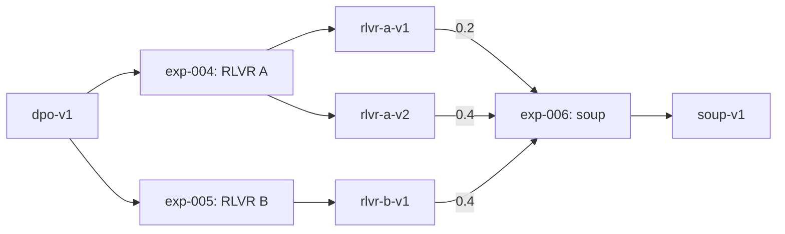

# Lightweight model version control

Modern AI model development usually involves several teams, each in charge of a different part
of the work: supervised fine-tuning, preference optimisation, reinforcement learning, checkpoint
merging and evaluation. Keeping the metadata of such a project up to date is hard when it is
scattered across notebooks, chats and spreadsheets. This repository is shared by all of those
teams to organise and keep track of the model's training, while adding as little documentation
burden as possible to the development itself.

This is a demo: every experiment, person, email address, organisation and revision in it is
fictional, so the links do not resolve.

## Start here

You only need Python 3.12 and Git to try this demo. From the repository root:

```bash
python3 -m venv .venv
source .venv/bin/activate
python -m pip install -r requirements.txt
python scripts/registry.py --check
```

The last command validates the records and prints the generated lineage. Success means exit
code 0 and a Markdown document starting with the pipeline title. Open [`LINEAGE.md`](LINEAGE.md)
to browse the existing graph and checkpoint scores on GitHub.

This repository tracks metadata. Training, uploading checkpoints to Hugging Face, model merging
and evaluation happen in your own tools. No GPU, Hugging Face login or model download is needed
to run this demo.

To register your own run:

1. Copy the template to an unused filename, for example:
   `cp experiments/_template.yaml experiments/exp-011-my-rlvr.yaml`.
2. Set a unique experiment `id` (for example `exp-011`), your `owner` details, the objective,
   `phase`, and the training `code` repository and commit. Use `status: running` when the run
   starts and leave `outputs: []` until you have evaluated checkpoints.
3. Choose a parent from the checkpoint table in [`LINEAGE.md`](LINEAGE.md). Copy its model ID,
   Hugging Face repository and exact revision into `inputs`; all three must match the registry.
4. Run `python scripts/registry.py --check`, commit your YAML file and open a pull request.
   CI validates it and shows a lineage preview in the Actions job summary. After merge, the
   workflow updates `LINEAGE.md`.
5. When results are ready, update the same YAML file with the output checkpoint, evaluation
   commit and every benchmark score. Give each checkpoint a unique ID. Set `status: accepted`
   if the team keeps the result, validate again and submit the update through a pull request.

Use immutable commit hashes for code and model revisions; quote hashes containing only digits
so YAML preserves leading zeros. `code.repo` uses GitHub's `owner/name` format. `eval.commit`
identifies the version of the shared evaluation code in `pipeline.yaml` that produced the scores.
The benchmark names must match that file's `benchmarks` list.

The two examples below are **existing records**: read or edit them in place to explore the demo.
Copying them into another file unchanged will fail validation because their IDs already exist.

## Example 1: a simple RLVR run — one parent, one output

RLVR means reinforcement learning with verifiable rewards: the training reward comes from a
checkable result, such as an exact answer match or passing unit tests. In
[`experiments/exp-005-rlvr-b.yaml`](experiments/exp-005-rlvr-b.yaml), a researcher starts from
`dpo-v1`, trains with exact-match rewards, and registers one evaluated checkpoint, `rlvr-b-v1`.

```text
dpo-v1 → exp-005 (RLVR) → rlvr-b-v1
```

```yaml
id: exp-005
title: RLVR with exact-match rewards
phase: rlvr
owner: {name: Researcher B, email: researcher-b@example.org, github: researcher-b}
status: accepted
method: rlvr
code: {repo: example-org/training, commit: 5e0f7a9}
inputs:
  - {model: dpo-v1, hf: {repo: example-org/dpo-v1, revision: 7b4a2d9}}
outputs:
  - id: rlvr-b-v1
    hf: {repo: example-org/rlvr-b, revision: 2f5b8d1}
    eval: {commit: d41e7aa}
    scores: {math: 0.589, code: 0.441, chat: 7.5, safety: 0.941}
```

`inputs` answers “which checkpoint did I start from?” and `outputs` answers “which checkpoints
did this run produce?” The experiment ID identifies the run; a model ID identifies a particular
checkpoint. One run can also produce several checkpoints: the parallel RLVR run
[`exp-004`](experiments/exp-004-rlvr-a.yaml) records both `rlvr-a-v1` and `rlvr-a-v2`.

## Example 2: a model soup — several parents, one output

Souping combines compatible checkpoints by averaging their corresponding model parameters into
one checkpoint. A weighted soup gives each input a chosen share of the average. The aim is to
combine useful behavior from different checkpoints; improvement must be checked by evaluation.
The checkpoints need compatible architectures and aligned parameters, typically from fine-tuning
the same base model. The resulting soup is one model to run or train further.

### Why keep several heads?

Parallel research runs can produce different useful candidates. Here, both RLVR runs start from
`dpo-v1`: run A's later checkpoint scores higher on code, while run B's checkpoint scores higher
on math. Keeping these candidate branch heads allows the team to compare them and combine them
later, instead of losing alternatives whenever it chooses a reference model.

Here “heads” means candidate checkpoints on parallel research branches, not neural-network
output heads or Git branches. There is no `heads` field to configure: each checkpoint is recorded
as an output and can be referenced by a later experiment. The registry has one `main` pointer
for the team's chosen reference; other checkpoints remain available as parents. A simple RLVR
run needs only one parent. A soup needs at least two because it averages multiple checkpoints.
It can also include an earlier checkpoint from a run, as this example does with `rlvr-a-v1`.



[`experiments/exp-006-soup.yaml`](experiments/exp-006-soup.yaml) records this merge:

```yaml
id: exp-006
title: Weighted soup of three RLVR checkpoints
phase: souping
owner: {name: Researcher A, email: researcher-a@example.org, github: researcher-a}
status: accepted
method: weighted_average
code: {repo: example-org/merging, commit: 8f3a21c}
inputs:
  - {model: rlvr-a-v1, hf: {repo: example-org/rlvr-a, revision: 6a1c3e5}, weight: 0.2}
  - {model: rlvr-a-v2, hf: {repo: example-org/rlvr-a, revision: 8c2e4f6}, weight: 0.4}
  - {model: rlvr-b-v1, hf: {repo: example-org/rlvr-b, revision: 2f5b8d1}, weight: 0.4}
outputs:
  - id: soup-v1
    hf: {repo: example-org/soup-v1, revision: 4c1d9e2}
    eval: {commit: d41e7aa}
    scores: {math: 0.612, code: 0.548, chat: 7.6, safety: 0.946}
```

The record uses the same structure as the RLVR run, with `phase: souping`, the merge code commit,
and a `weight` for every parent. The weights sum to 1: each output parameter is
`0.2 × rlvr-a-v1 + 0.4 × rlvr-a-v2 + 0.4 × rlvr-b-v1` for the corresponding input parameters.
All three parents are needed to describe and reproduce that merge. Recording only one would
hide the other contributors and make the ancestry incomplete.

Run the merge and shared evaluation externally, then record the resulting checkpoint and scores.
The demo's soup scores higher than its parents on all four benchmarks; these fictional results
do not imply that averaging always improves a model. This is parameter averaging; an ensemble
instead runs multiple models and combines their predictions.

## Choosing main and keeping rejected work

When a checkpoint becomes the team's reference model, change the `main:` line in
[`pipeline.yaml`](pipeline.yaml) in a reviewed pull request. That file also lists the phases,
benchmarks and external base models. You do not need to change `main` to register a new run.

For an experiment the team rejects, use the *Rejected experiment* issue form to record its
parents, checkpoints, scores and reason, then close the issue as not planned. Rejected work is
kept in issues rather than the registry. See the rejected
[learned-reward RLVR run](https://github.com/alobo01/lightweight-model-version-control/issues/1)
and [uniform soup](https://github.com/alobo01/lightweight-model-version-control/issues/2).

Nobody draws the full lineage by hand. On every merge, GitHub Actions compiles the experiment
files into [`LINEAGE.md`](LINEAGE.md), including the graph, code versions and checkpoint scores.
Ancestry comes from the declared parents and outputs, never from the order of the phases.

## What is checked

Before anything is merged, `scripts/registry.py` checks that each owner is complete, that the
code points to a GitHub repository (`owner/name`) and a commit, and that every checkpoint has a
pinned revision, an evaluation commit and a score for each benchmark. It also checks that every
parent exists and matches the registered revision, that soup weights sum to one, that the `main`
pointer is valid and that the lineage contains no cycles. A pull request that breaks any of these
fails, with a message naming the experiment at fault.

```bash
pip install -r requirements.txt
python scripts/registry.py          # validate and write LINEAGE.md
python scripts/registry.py --check  # validate and print, without writing
pytest
```

The workflow never downloads weights, runs benchmarks or calls external services. If `main` is a
protected branch, allow it to push the regenerated `LINEAGE.md`, or run the script before merging.

## Repository layout

```
pipeline.yaml          phases, benchmarks, base models, main pointer
experiments/           one YAML file per experiment
scripts/registry.py    validator and graph compiler
tests/                 validator tests
.github/               workflow, pull request template, rejected-experiment issue form
LINEAGE.md             generated output
```

## Citation

If you use or adapt this approach, please cite:

> Antonio Lobo-Santos. *Lightweight model version control*. GitHub repository, 2026.
> https://github.com/alobo01/lightweight-model-version-control

```bibtex
@misc{lobosantos2026lightweight,
  author       = {Lobo-Santos, Antonio},
  title        = {Lightweight model version control},
  year         = {2026},
  howpublished = {\url{https://github.com/alobo01/lightweight-model-version-control}}
}
```
