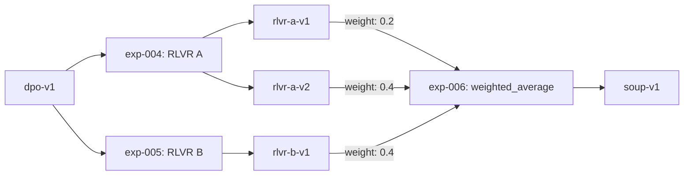

# Lightweight model version control

Modern AI model development usually involves several teams, each responsible for a different part
of the work, such as supervised fine-tuning, preference optimisation, reinforcement learning, checkpoint
merging or evaluation. Keeping a project's metadata up to date is hard when it is
scattered across repositories, chats and spreadsheets. This repository is a template that teams can share
to organise and track model training while adding as little documentation burden as possible.
It also provides a GitHub Actions workflow that generates a lineage graph and summary in `LINEAGE.md`.

The [generated demo lineage](LINEAGE.md) shows a complete training chain, branching RLVR runs,
weighted souping, multiple tags, in-progress experiments and rejected alternatives.
All repositories, revisions and scores in these examples are fictional.

To see how the template works, let's start with a demo of a reinforcement learning with verifiable rewards (RLVR) experiment.

## Example 1: a simple RLVR run — one parent, one output

We will start with a simple experiment that begins from a previous checkpoint (e.g., the output of a post-training step such as DPO) and produces a single output checkpoint.
For reproducibility, another researcher needs to know three things:

1. **Code:** Where to find the code (the repository), which version was used (the commit), and which configuration was used (e.g., CLI parameters or a YAML file).
2. **Initialisation:** Which checkpoint the experiment started from, including its Hugging Face repository and revision.
3. **Output:** Where to find the output checkpoint, including its Hugging Face repository and revision, and how well it performed in evaluation. The scores also help track progress.

Other useful metadata includes:

1. **Owner:** Who to contact about the experiment.
2. **Title:** A short name that identifies the experiment.
3. **Description:** One sentence explaining why the experiment is being run and what it will do.
4. **Tags:** Optional, free-form labels such as `rlvr`, `sft`, or `ablation`. Tags automatically determine graph colours.
5. **Dates:** When the experiment began and ended.
6. **Status:** Whether the experiment is in progress, accepted or rejected.


In [`experiments/exp-005-rlvr-b.yaml`](experiments/exp-005-rlvr-b.yaml), a researcher starts from
`dpo-v1`, trains with RLVR, and registers one evaluated checkpoint, `rlvr-b-v1`.

```text
dpo-v1 → exp-005 (RLVR) → rlvr-b-v1
```

```yaml
id: exp-005
title: RLVR with exact-match rewards
description: Test whether exact-match rewards improve reasoning by fine-tuning dpo-v1 with RLVR.
tags: [rlvr, reasoning]
owner: {name: Researcher B, email: researcher-b@example.org, github: researcher-b}
status: accepted
method: rlvr
code: {repo: example-org/training, commit: 5e0f7a9}
config:
  file: configs/rlvr.yaml
inputs:
  - {model: dpo-v1, hf: {repo: example-org/dpo-v1, revision: 7b4a2d9}}
outputs:
  - id: rlvr-b-v1
    hf: {repo: example-org/rlvr-b, revision: 2f5b8d1}
    eval: {repo: example-org/evaluation, commit: d41e7aa}
    scores: {math: 0.589, code: 0.441, chat: 7.5, safety: 0.941}
```

The `title` names the run; `description` explains its motivation and planned approach in one line.

`config.file` is a path in the code repository at the recorded commit. Instead of a file,
you can record CLI arguments, or include both fields when the invocation uses both:

```yaml
# CLI arguments only
config:
  cli: "--seed 42 --learning-rate 1e-6"
```

```yaml
# Config file and CLI arguments
config:
  file: configs/rlvr.yaml
  cli: "--seed 42 --learning-rate 1e-6"
```

Configuration is optional metadata. The registry records it without fetching files, executing
commands or interpreting which settings take precedence.

We might run several instances of this experiment, for example with different seeds. We may also want to discard an experiment while recording what was done and why, so that other researchers can learn from it. Keep its YAML record in [`rejected/`](rejected/) with `status: rejected`, as described below.

Modern AI development also uses weight aggregation techniques such as souping. The next example shows how to record them.

## Example 2: weight aggregation — several parents, one output

We will now combine several checkpoints into one model using a weighted soup: an average of
their corresponding parameters. The checkpoints must have compatible architectures and aligned
parameters, typically because they were fine-tuned from the same base model. Evaluation is needed
to determine whether the resulting model improves on its inputs.

To record weight aggregation, specify:

1. **Inputs:** Every checkpoint being combined, including earlier checkpoints from a run.
2. **Method:** The aggregation method, here `weighted_average`.
3. **Parameters:** A dictionary on each input describing its role in the aggregation. Here,
   `weight` is each input's share of the average; the example uses weights summing to 1.

Here, two RLVR runs start from `dpo-v1`. The soup combines two checkpoints from run A and one
from run B into `soup-v1`. Each checkpoint is recorded as an output of its experiment and can
be used as a parent, even if it is not the team's current reference model.



[`experiments/exp-006-soup.yaml`](experiments/exp-006-soup.yaml) records this merge:

```yaml
id: exp-006
title: Weighted soup of three RLVR checkpoints
tags: [weight_aggregation, souping]
owner: {name: Researcher A, email: researcher-a@example.org, github: researcher-a}
status: accepted
method: weighted_average
code: {repo: example-org/merging, commit: 8f3a21c}
inputs:
  - {model: rlvr-a-v1, hf: {repo: example-org/rlvr-a, revision: 6a1c3e5}, parameters: {weight: 0.2}}
  - {model: rlvr-a-v2, hf: {repo: example-org/rlvr-a, revision: 8c2e4f6}, parameters: {weight: 0.4}}
  - {model: rlvr-b-v1, hf: {repo: example-org/rlvr-b, revision: 2f5b8d1}, parameters: {weight: 0.4}}
outputs:
  - id: soup-v1
    hf: {repo: example-org/soup-v1, revision: 4c1d9e2}
    eval: {repo: example-org/evaluation, commit: d41e7aa}
    scores: {math: 0.612, code: 0.548, chat: 7.6, safety: 0.946}
```

The record follows the same structure as the RLVR run, with `tags: [weight_aggregation]`,
`method: weighted_average` and `parameters: {weight: ...}` on each input. For each model parameter,
the output is `0.2 × rlvr-a-v1 + 0.4 × rlvr-a-v2 + 0.4 × rlvr-b-v1`.

Other aggregation methods can use their own method names and parameter dictionaries, including
nested values. Parameters appear on input arrows and in the lineage table; omitted or empty
dictionaries leave arrows unlabelled. Shared run settings belong in `config`. The registry
validates metadata structure; the referenced aggregation code handles method-specific rules.

The demo's fictional soup scores higher than its parents on all four benchmarks, but averaging
does not always improve a model.

## Usage

Add experiment metadata through pull requests; GitHub Actions validates it and updates the lineage
automatically. No local installation, compilation or tag registration is needed.

1. **Start from `main`, add your experiment YAML on a new branch, and open a pull request.**
   From your local repository, run:

   ```bash
   git switch main
   git pull --ff-only
   git switch -c exp-011-my-experiment
   cp experiments/_template.yaml experiments/exp-011-my-experiment.yaml
   # Edit the YAML: fill in IDs, owner, method, code, pinned inputs and run configuration.
   # Use status: in_progress and outputs: [] until evaluated checkpoints are available.
   git add experiments/exp-011-my-experiment.yaml
   git commit -m "Register exp-011"
   git push -u origin exp-011-my-experiment
   gh pr create --base main --title "Register exp-011" --body "Add metadata for exp-011."
   ```

   Choose an unused experiment ID and branch name. The last command opens a pull request using
   the GitHub CLI. If `main_branch` in `config.yaml` differs
   from `main`, use that branch in `git switch` and `gh pr create --base`.
2. Run training or merging and evaluation outside this repository. Add each resulting checkpoint,
   its pinned Hugging Face revision, evaluation repository and commit, and benchmark scores to the experiment file.
   Commit and push those updates to the same branch to update the pull request.
3. Review the GitHub Actions checks and lineage preview in the workflow summary, then merge the
   pull request. GitHub Actions regenerates and commits `LINEAGE.md` automatically on `main_branch`.

Tags need no predefined vocabulary or colour configuration. Each distinct tag gets a different
automatically generated colour and an entry in the graph legend. For multiple tags, the first
colours the experiment and its output checkpoints; all tags remain visible. Omit `tags` or use
`tags: []` for untagged experiments. Green arrows mark accepted experiments, red arrows rejected experiments, and dashed grey arrows work in progress.

[`config.yaml`](config.yaml) contains the project settings:

```yaml
project_name: Alignment training pipeline (demo)
main_branch: main
```

`project_name` titles the generated lineage; `main_branch` is the Git branch where GitHub Actions
publishes it. Record checkpoints in experiment inputs and outputs. An input without a producing
experiment is an external checkpoint; include its Hugging Face repository and revision directly.
You can also record its evaluation code and scores on the input. Benchmark columns are collected
from recorded scores, with `–` for missing values.

See [CI_CD.md](docs/github_workflow/CI_CD.md) for the GitHub validation and publication workflow.

## Rejecting an experiment

1. Move the experiment's YAML file from `experiments/` to [`rejected/`](rejected/).
2. Set `status: rejected` and record why it was rejected in `reject_reason`. Keep its existing ID,
   inputs, method, configuration, outputs and scores so others can learn from the result.
3. Commit the change. GitHub Actions validates the record and updates `LINEAGE.md` automatically.

For example, after moving the RLVR record to `rejected/exp-005-rlvr-b.yaml`, update these
fields while preserving the rest of the record:

```yaml
status: rejected
reject_reason: Exact-match rewards did not improve reasoning scores enough to justify the training cost.
```

`reject_reason` records the rejection decision; `description` retains the original motivation
and approach. Use `notes` for any other context.

For work that was never registered, copy [`rejected/_template.yaml`](rejected/_template.yaml)
to a new YAML file in `rejected/`, fill in its metadata and commit it.
An experiment with no resulting checkpoints can have `outputs: []`.

Rejected records use the same schema as other experiments. They are listed with links to their
YAML files in the generated **Rejected experiments** section. Their branches appear with red
arrows in the overview; their checkpoints stay outside the active checkpoint table. If other experiments use a rejected checkpoint, move those dependent
experiments to `rejected/` too, or update their inputs.

## Compiling the lineage

The registry compiles [`LINEAGE.md`](LINEAGE.md) from `config.yaml`, `experiments/` and `rejected/`.
It includes a graph, code versions and checkpoint scores. Ancestry comes from the declared inputs
and outputs; experiments are listed by ID. GitHub Actions validates and publishes it automatically.
See [CI_CD.md](docs/github_workflow/CI_CD.md) for the workflow, permissions and optional local checks.
Do not edit `LINEAGE.md` by hand.

## Repository layout

```
config.yaml            project_name and main_branch
experiments/           one YAML file per active experiment
rejected/              rejected experiment YAML files (status: rejected)
scripts/registry.py    validator and graph compiler
tests/                 validator tests
.github/               workflow and pull request template
LINEAGE.md             generated output
docs/github_workflow/  GitHub automation, validation and optional local checks
```

## Citation

If you use or adapt this approach, please cite:

> Antonio Lobo-Santos. *Lightweight model version control*. GitHub repository, 2026.
> https://github.com/alobo01/lightweight-model-version-control

```bibtex
@misc{lobosantos2026lightweight,
  author       = {Lobo-Santos, Antonio},
  title        = {Lightweight model version control},
  year         = {2026},
  howpublished = {\url{https://github.com/alobo01/lightweight-model-version-control}}
}
```
